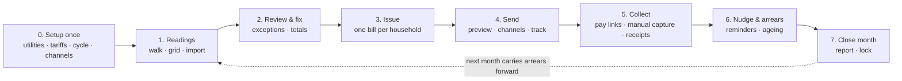

# Estate billing & utilities management — workflow draft (estate manager)

**Status: DRAFT — for owner finetuning, no build/release claim.**
**Date:** 2026-11-13 · **Author:** release agent · **Target module:** estate-manager bill & utility sending + management
**Related:** [`automated-billing-contract.md`](automated-billing-contract.md) · [`billing-invoices-contract.md`](billing-invoices-contract.md) · [`estate-billing-reports-contract.md`](estate-billing-reports-contract.md) · [`increment-13-acceptance.md`](increment-13-acceptance.md)

---

## 1. North star

> The estate manager should be able to run an entire month of utility billing — readings, bills, sending, reminders, collection — in **one sitting of about 15 minutes**, and see the money land.

Two product feelings we are designing for:

- **"WOW"** — the first bill run should feel like the estate got a finance department overnight: a guided cockpit with live totals, anomaly warnings and one-tap sending to every resident.
- **STICKY** — the monthly ritual (run → send → collect → close) is the reason the estate keeps the product. Each month it gets faster, arrears shrink, residents pay without calling, and the owner gets a clean collection report.

**Success metrics (to be tracked in the module):**

| Metric | Today (manual) | Target after module |
|---|---|---|
| Time to issue a month of utility bills | hours / days | **≤ 15 min** |
| Share of residents reached | unknown | **100% reachable** (in-app + email; SMS/WhatsApp when gateway on) |
| Dues collected within 7 days | unknown | **≥ 80%** |
| Resident calls to the office about bills | high | **down > 50%** |
| Repeat use (manager logs in each billing cycle) | n/a | **monthly ritual** |

---

## 2. What already exists vs what is missing

The **engine exists** — the **cockpit does not**. That is the whole module.

| Capability | Status | Where |
|---|---|---|
| Utility schedules (flat / metered / both, tariff per unit, period, lead days, due days, reminder cadence, `send_on_generate`) | ✅ built | `billing_schedules` + platform `/platform/billing/schedules` |
| Billing automation (generate bills, send, reminders, deliveries) — idempotent, dry-run, estate-scoped | ✅ built | `php scripts/billing-automate.php --scope=all|send|deliveries|reminders` |
| Utility charge records (meter readings, pricing snapshot) | ✅ built | `utility_charges` |
| Channel sending: email + in-app always; SMS/WhatsApp only when a gateway is configured; dedupe; reminder before due + on due | ✅ built | `BillingNotificationService`, `notification_logs` |
| Payment links + provider webhooks (signed, idempotent) | ✅ built | `/pay/{token}`, `/webhooks/payments/*`, `billing_payments` |
| Resident bills: list + invoice-style detail + pay | ✅ built (invoice card refreshed 2026-11-13) | `/app/bills`, `/app/bills/{uuid}` |
| Estate read-only billing overview, invoice detail, reports, CSV | ✅ built (Inc-11) | `/admin/billing*` |
| **Estate-manager reading capture (walking the estate, per-household meters)** | ❌ missing | — |
| **Bill-run cockpit: period → readings → review → issue → send** | ❌ missing | — |
| **Anomaly checks & exceptions before sending** | ❌ missing | — |
| **Estate-manager send preview / batch send / resend failed** | ❌ missing | — |
| **Manual payment capture & reconciliation in estate scope** (M-Pesa code, cash) | ❌ missing (platform has its own screens) | — |
| **Nudge / arrears board / one-tap reminders** | ❌ missing | — |
| **Collection dashboard + month close** | ❌ missing | — |
| **Resident bill transparency ("how was this calculated?", receipts, query)** | ❌ partial (payment marker only) | — |

**Ownership decision baked into this draft:** the **estate manager owns utility bills for their estate** (readings, issue, send, collect, close). **Platform finance keeps subscription/estate invoicing** (already built). The module lives under `/admin/billing/…` (estate scope), not `/platform`.

---

## 3. Roles

| Role | Can do | Existing permissions |
|---|---|---|
| **Estate manager / estate admin** | set up utilities & tariffs, capture readings, run/review/issue bills, send/nudge, record payments, close month, export | currently only `billing.subscription.view`; needs a manage capability (**§9 decision D2**) |
| **Resident / tenant / household member** | view invoice, pay, receipt, query/“I have paid” | auth + household ownership (no permission node) |
| **Platform finance** | subscription invoices, provider/channel config, view estate utility health | `billing.subscription.manage`, `billing.invoice.view`, `billing.payment.manage` |
| **Guard / parking** | nothing in billing | — |
| **Owner / board (report reader)** | download the monthly collection summary | estate admin export |

---

## 4. Workflow at a glance



**The 15-minute ritual (target):**
1. Open **Billing home** → "November bill run is ready to start" (or it already ran on auto-pilot).
2. **Readings** — enter water/electricity readings in a grid; "copy last month" and "not occupied" one tap each.
3. **Review** — a pre-flight panel says *“121 bills · KES 486,200 · 3 exceptions”*. Fix the 3 inline (spike, missing reading, inactive household).
4. **Issue** — one button. Bills exist; residents get in-app/email instantly.
5. **Send** — preview the resident message, choose channels, send; watch delivery counts, resend failed.
6. **Collect** — as payments land, mark cash/M-Pesa code payments in one tap and auto-send receipts.
7. **Close** — "Month closed · 87% collected · KES 42,300 outstanding" → export/share summary.

---

## 5. Stage detail (screens, states, edge cases)

### Stage 0 — Setup once (5 minutes, usually once per estate)

**Screen: Billing → Utilities & tariffs**

- Utilities enabled per estate: **Water, Electricity, Garbage/Refuse, Security, Other** (free label). Per utility:
  - charge basis: **flat per household / metered / flat + metered** (matches `utility_charges.charge_model`)
  - tariff (KES per unit) and/or flat amount, **unit label** (m³, kWh, “per month”)
  - who is billed: active households (default) with per-household overrides/exemptions
  - **period**: monthly (default), quarterly, weekly; **anchor** 1st of month (already supported), month-end clamp
  - **due in** days (default 14), **reminder** days before due (default 3) + on due (default on)
  - **send on generate** default: on
- **Billing messages**: choose channels (in-app/email always; SMS/WhatsApp when a gateway exists), sender identity, whether reminders go to the household primary member.
- **Branding**: estate display name + logo on the invoice (already estate name in invoice card; add logo later).
- **Auto-pilot toggle**: “Run on the 1st at 8:00 · send automatically” (off by default for the first cycles).

States: `draft` (defaults pre-filled) → `active`. Everything editable later except periods already issued.

### Stage 1 — Readings (only for metered components)

**Screen: Billing → Run → Readings (period = Nov 2026)**

- Grid: **household rows × utility columns**, big numeric inputs. Per cell:
  - last reading shown faintly (`reading_end_units` of previous period) → manager types the new reading; **units consumed** auto-computed
  - actions: `Copy last reading` (no usage), `Not occupied` (skip), `Flat only` (no reading needed), `Exempt`
  - live row total preview (usage × tariff + flat)
- **Fast entry**: Enter/Next moves down the column; search by unit; filter “needs reading”.
- **CSV import** (Phase 2): paste a meter export; validation preview before applying.
- **Mobile-first**: the same grid as a list of houses with steppers for walking around the estate.

Edge cases handled explicitly: inactive/archived household (skip, not billed), no previous reading (first bill = reading start), reading lower than previous (**meter rollover / tamper warning** → requires confirm), huge jump (anomaly), house marked not occupied but has usage (warn).

### Stage 2 — Review & fix (the WOW screen)

**Screen: Billing → Run → Review**

- Sticky summary header: **“121 bills · 118 ready · KES 486,200 · 3 exceptions”** with a 5-step rail (Period · Readings · Review · Issue · Sent).
- **Exceptions queue** (cards, fix inline without leaving):
  - missing reading (< required)
  - usage spike > 30% vs 3-month average → show sparkline and “check meter / accept”
  - zero usage on a metered household → confirm “flat only?” or “not occupied”
  - household deactivated mid-cycle
  - duplicate period already exists (idempotency — should never double-bill)
  - missing tariff
- **Preview table** of every household bill: unit, utility, readings, units, tariff, flat, total; expandable row → full invoice preview (same invoice card residents get).
- **Bulk tools**: exclude selected, apply flat-only, “fix all similar”.
- **Approve** → generates one invoice per household (`open`, due date, kind=utility, period) — atomic + idempotent, audited (`billing.run_issued`).

**Nothing is sent yet.** Issue ≠ send, so the manager can still fix and re-issue; re-issue updates the draft bill numbers, never duplicates.

### Stage 3 — Issue

- One button **“Issue 118 bills”** → invoice rows created, `notification_logs` untouched.
- Result toast: **“118 bills issued · KES 486,200 · due 26 Nov”** + link to Send.
- Guardrails: already-issued period shows “issued, can re-send or void”.

### Stage 4 — Send (the money moment)

**Screen: Billing → Run → Send**

- **Message preview per channel** (in-app, email, SMS, WhatsApp)* — shown exactly as the resident sees it, with the invoice total, due date, pay link, or “View bill”.
- **Channel availability** is honest: in-app + email always; SMS/WhatsApp appear only when a gateway is configured for the estate (existing channel settings). If not configured: show “Not configured” + a one-tap **“Share on WhatsApp”** fallback that opens the manager’s WhatsApp with the message pre-filled (no gateway cost, same day delivery).
- **Send** → live counters: `sent · skipped · failed` per channel; **resend failed**; per-household delivery drawer (“reached on email 08:02”).
- **Schedule**: send now, or “tomorrow 08:00”.
- **Auto-pilot** (Phase 2): if enabled, this stage runs itself and the manager only sees the report.

States per household: `not sent / sent / delivered (email) / skipped (no channel) / failed → retry`.

### Stage 5 — Collect & reconcile

**Screen: Billing → Collections (or the run’s Collect tab)**

- **Payment links** are already issued inside bills — resident taps *Pay* (M-Pesa/card as configured).
- **Manual capture** (the 90% case for cash/M-Pesa tick): pick a bill → *Record payment* → amount (default = balance), method `M-Pesa / Cash / Bank / Cheque`, reference (M-Pesa code), date → **auto-receipt** to the resident (in-app + email/SMS/WhatsApp if configured) and bill becomes `paid` when fully covered (existing ledger rules: partial payments allowed, confirmed → auto paid).
- **Reconciliation view**: provider webhook payments land automatically with reference matching; unmatched payments sit in a small “needs linking” list.
- **Resident “I have paid”** flag: creates a notification for the manager with the reference the resident typed → manager confirms in one tap (reduces calls, feels responsive).

### Stage 6 — Nudge & arrears (the sticky loop)

**Screen: Billing → Collections → Who to nudge**

- Ageing buckets: **due soon · 1–7 days late · 8–30 · 31+**, counts and KES per bucket.
- **One-tap nudge**: sends the reminder message to selected households (dedupe prevents spam). Templates:
  - before due (existing reminder engine) · on due · “friendly nudge” (7 days late) · “final notice” (30+ days, wording set by estate)
- **Skip already-paid / already-nudged**, show “last reminded 2 days ago”.
- **Statement per household** (PDF/print-friendly or link) for the “I paid for everything” conversation.
- Phase 2: payment plans (split balance), late fees (contract decides), service restriction — **not MVP** (see §9 D7).

### Stage 7 — Close month

**Screen: Billing → Run → Close → Collection summary**

- Big numbers: **Billed · Collected · Outstanding · Collection rate %**; channel split (M-Pesa/cash); top payers; top arrears; per-utility and per-building breakdown (reuses Inc-11 reports).
- **Export CSV** (already exists) + “Share/brief for the owner” (printable summary page).
- **Close & lock**: bills and readings for that period become read-only (reopen with audit + reason). Locking is what makes the ritual feel finished and keeps numbers trustworthy.
- Next month automatically rolls arrears forward as `past_due`.

---

## 6. "Wow" & "sticky" design layer (what we are really selling)

### For the estate manager (the buyer's daily delight)

1. **The 5-step bill-run cockpit** with a readiness ring (“92% ready · 3 exceptions”) — the single most important screen; it turns a spreadsheet evening into a guided 15 minutes.
2. **Anomaly cards, not error pages** — every problem is a card with a one-tap fix (accept spike / mark not occupied / flat only).
3. **Live totals while typing readings** — the manager sees money being billed in real time.
4. **Auto-pilot** — “next run in 6 days · 118 households · sends automatically” turns the product into an installed habit.
5. **Collection ring on Billing home** — billed vs collected, today's cash-in, arrear ageing; the number that makes them open the app every morning.
6. **Month-close celebration** — a shareable collection summary card (“87% collected in 9 days”) that the manager can send to the owner/board. This is the social proof that renews the subscription.
7. **Saved diligence**: the run shows “same as last month, only 2 exceptions” — the product visibly gets smarter/faster over time.

### For the resident (the person who actually pays)

1. **Invoice document, not a scary “amount due”** — invoice number, billed-to house details, period, one clear line, total due, one button (shipped 2026-11-13).
2. **Pay in under 30 seconds** from the invoice; receipt immediately in-app + message.
3. **“How this bill was calculated”** — tariff × units + flat, plus last 3 months consumption sparkline (transparency kills disputes).
4. **"I have paid" / query** — two buttons that create a tracked follow-up instead of a phone call.
5. **Quiet trust** — only the household's own bills, never another unit's data; visible payment history; no “where is my receipt?”.

### Promotion hooks (how this sells the product)

- Demo script: **“Watch a month of estate billing go out in 4 minutes”** (issue → send → first payment arrives in the demo).
- Before/after: **“3 days on WhatsApp and Excel → 15 minutes”**; **“80% of dues in 7 days”** as a launch claim measured by the dashboard.
- The **owner collection report** is a leave-behind: managers share it upward → the owner sees the product value without logging in.
- Resident NPS micro-loop: after paying, one-question “How easy was this?” — feeds the promo page.

### Sticky mechanics (retention by design)

- **Monthly cadence** = 12 reasons a year to open the app; auto-pilot makes it effortless.
- **Switching cost grows** month over month: readings history, payment ledger, arrears trail, audited bills.
- **Data gravity**: consumption history + payment behaviour power the sparklines, anomaly detection and statements.
- **Ritual rewards**: month-close summary + growing collection rate.
- **Multi-surface reach**: resident pays in-app/WhatsApp; manager works on desktop or phone; owner reads the summary.

---

## 7. Message templates (channel-ready, short by design)

| Trigger | In-app / email subject | Body (WhatsApp/SMS shape) |
|---|---|---|
| Bill issued | “Your Nov 2026 utility bill” | “Hi {{name}}, your {{estate}} {{period}} bill is {{amount}}. Due {{due}}. View & pay: {{link}}” |
| Reminder (due-3) | “Reminder: bill due in 3 days” | “Hi {{name}}, your {{period}} bill of {{amount}} is due in 3 days. Pay: {{link}}” |
| On due | “Bill due today” | “Friendly reminder: {{amount}} due today. Pay: {{link}}” |
| Nudge (late) | “Friendly nudge on your bill” | “Hi {{name}}, we haven't seen payment for {{period}} ({{amount}}). If you've paid, reply with the M-Pesa code.” |
| Receipt | “Payment received – thank you” | “Received {{amount}} for {{invoice}}. Receipt: {{link}}” |
| Month close (manager) | — (in-app) | “Nov 2026 closed: 87% collected, KES 42,300 outstanding.” |

Rules: no PINs/OTP in messages, no phone numbers in logs, dedupe per household/period/event, honest “skipped (channel not configured)” rows.

---

## 8. Data & surface delta (proposed, for sizing only — not built)

**Reuse (no schema change):** `billing_schedules`, `utility_charges`, `billing_invoices`, `billing_payments`, `notification_logs`, estate `billing_meta` settings, CSV export, pay links/webhooks.

**Small additions (to decide in tuning):**

| Need | Proposal | Cost |
|---|---|---|
| Bill run as a first-class object (period, status, exceptions, issued/sent counters, closed lock) | new `billing_runs` table **or** derive from `billing_schedules.last_period_key` + invoice period (less auditable) | 1 migration if table; recommend table for the lock/audit + “readiness” state |
| Readings capture per household | existing `utility_charges` (reading_start/end/source manual) fits; add `billing_runs` link reference | no new columns needed |
| Manual payment capture estate scope | existing `billing_payments` + audit; add estate routes | no schema |
| Receipt/share summary | generate from invoice/payment data; optional store snapshot | none |
| Notification templates per estate | platform settings exist; add estate-level template overrides later | phase 2 |
| Reading anomalies | compute on the fly (no store) | none |

**Proposed routes (estate scope, `/admin/billing/…`):**

```
GET  /admin/billing                         — Billing home: collection ring, next run, arrears, shortcuts (extend Inc-11 page)
GET  /admin/billing/utilities               — Utilities & tariffs (estate settings fold-in)
GET  /admin/billing/run/{period}            — 5-step run cockpit (readings → review → issue → send)
POST /admin/billing/run/{period}/readings   — save readings (bulk)
POST /admin/billing/run/{period}/issue      — issue bills (idempotent, audited)
POST /admin/billing/run/{period}/send       — send / resend (channels, dedupe)
POST /admin/billing/run/{period}/close      — close & lock month
GET  /admin/billing/collections             — ageing buckets, who to nudge, unmatched payments
POST /admin/billing/bills/{uuid}/payments   — record manual payment (auto-receipt)
POST /admin/billing/bills/{uuid}/nudge      — one-tap reminder
POST /admin/billing/bills/{uuid}/void       — void with reason (audit)
GET  /admin/billing/export.csv              — exists (extend filters)
```
Resident side unchanged (`/app/bills…`); optionally add “I have paid” + “query” POSTs.

---

## 9. Decisions to finetune (recommendations in bold)

| # | Decision | Options | Recommendation |
|---|---|---|---|
| D1 | Who issues utility bills | platform finance / **estate manager** / both | **estate manager** for utility bills; platform keeps subscription invoices |
| D2 | Permission model | reuse `billing.subscription.view` + estate-admin role gate / add **`billing.subscription.manage`** grant / add a new `billing.utility.manage` node | **new `billing.utility.manage`** (estate_admin + estate_manager only; 1 node, +2 role links, gates stay clean). Alternative zero-schema: role gate on estate scope |
| D3 | Send mode | always auto / **approve-then-send** / per-estate toggle | **approve-then-send by default**; auto-pilot opt-in after first 2 clean runs |
| D4 | Readings capture | grid only / **grid + copy last + not-occupied** / + CSV import | **grid + copy/not-occupied** in MVP; CSV import phase 2 |
| D5 | Channels in MVP | in-app+email only / **+ "Share on WhatsApp" fallback** / real API SMS/WhatsApp | **in-app+email + share fallback**; real API once gateway is configured |
| D6 | Payments | pay links only / **+ manual capture (M-Pesa code, cash)** / Daraja STK/autopay | **manual capture + webhooks** in MVP (works today); STK/autopay phase 2 |
| D7 | Arrears policy | reminders only / **reminders + statements** / penalties/payment plans/restriction | **reminders + statements** in MVP; no automatic penalties |
| D8 | Month close | none / **close & lock + reopen with reason** | **close & lock** (audit trail) |
| D9 | Resident transparency | amount only / **calculation breakdown + consumption sparkline + “I have paid”/query** | **breakdown + “I have paid”/query** in MVP; sparkline if data allows |
| D10 | Branding on invoice | text only / **estate name + logo** / full colour theme | estate name now; **logo phase 2** |
| D11 | Woo screen priority | dashboard first / **bill-run cockpit first** | **cockpit first** (the 15-min wow), dashboard second |

---

## 10. MVP → later (scope ladder)

**MVP (ship first, one increment):**
1. Billing home shows this month's run state + collection ring (extend existing `/admin/billing`).
2. Readings grid with copy-last / not-occupied + live totals.
3. Review screen with exception cards (spike, missing reading, inactive) + preview table.
4. Issue (idempotent, audited) and send with per-channel preview + delivery counters + resend failed (in-app/email; share-on-WhatsApp fallback).
5. Manual payment capture + auto-receipt; collections ageing buckets + one-tap nudge.
6. Close month with summary + CSV export + lock.
7. Permissions/route gates + full test coverage (static + HTTP + clean markup), no new resident routes.

**Phase 2:** CSV meter import, auto-pilot (scheduled runs + send), consumption sparkline on resident invoice, "I have paid"/query flow, estate invoice branding/logo, unmatched-payment linker.

**Phase 3:** Daraja STK/autopay, payment plans/late fees per contract, SMS/WhatsApp API with template management, owner multi-estate roll-up, printable PDF invoices, reading photo/OCR.

**Explicitly out of scope:** general ledger/accounting exports beyond CSV, bank feeds, multi-currency, credit notes/refunds workflow (platform already has payment status tools; estate gets void + payment reversal request), guard-side billing.

---

## 11. Acceptance criteria for the draft (when we build it)

- A manager can complete a month from a cold start in **≤ 15 minutes** on desktop, and readings entry works on a 390px phone.
- Issuing twice for the same period **never** creates duplicate bills (idempotent + audit).
- Every send shows honest per-channel outcomes in `notification_logs` (sent/skipped/failed, no secrets).
- Manual payment → invoice auto-`paid` when covered; receipt reaches the resident (in-app/email; SMS/WhatsApp if configured).
- Month close is locked; reopen requires a reason and is audited.
- No cross-estate or cross-household data exposure in any screen or export.
- Numbers reconcile: **billed = Σ invoice totals**, **collected = Σ confirmed payments**, **outstanding = billed − collected − waived**.

---

## 12. Demo story for promotion (4 minutes)

1. 0:00 — “Meet Grace, estate manager at Greenview. It's the 1st of the month.”
2. 0:20 — Billing home: “118 households · November run ready · 3 exceptions” → tap **Start run**.
3. 0:45 — Readings: type two water readings, tap *copy last* for three empty houses; money total ticks up.
4. 1:30 — Review: exceptions panel — accept one spike, mark one not-occupied, done: **“100% ready”**.
5. 1:50 — **Issue** → **Send**: preview the exact WhatsApp a resident gets; send; counters fill.
6. 2:30 — Resident phone (split screen): opens invoice, taps Pay — done in 20 seconds; receipt appears.
7. 3:00 — Manager Collections: collection ring moves, one-tap nudge a late unit.
8. 3:40 — **Close month**: “87% collected in 9 days” — share the summary with the owner.

The wow is not a feature list; it is **watching money move in 4 minutes**.

---

## 13. Questions for you to finetune

1. Who should own utility bill issuing — estate manager (draft assumption) or platform finance?
2. Is "approve → send" the right default, or do you want auto-pilot available from day one?
3. Should we add the new `billing.utility.manage` permission node, or gate the module by estate-admin/manager role without touching the permission/links count?
4. MVP readings: grid only, or grid + CSV import in the first release?
5. Manual payment capture (M-Pesa code/cash) — in MVP? (Recommended: yes — that's what actually closes bills today.)
6. Arrears: reminders + statements only, or should penalties/payment plans be in the first release?
7. Which wow moment should lead the demo/promo: the bill-run cockpit, or the resident invoice + 30-second pay?
